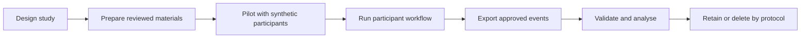

# User Study Workflow

A reference implementation for planning, running, and analysing a small browser-based user study. It combines a participant-facing study flow with a lightweight event schema, a local demo store, and a Python export/validation step.

This repository is a **workflow reference**, not a validated research platform. Its sample study and consent text are fictional placeholders. The included browser store is for local demonstration only; it is not appropriate for real participant recruitment or data collection.

## Workflow at a glance



## What the workflow covers

1. Define the study question, participant journey, tasks, and measures.
2. Prepare and obtain review of study-specific participant information and consent.
3. Configure the participant-facing pages and task materials.
4. Pilot the flow using synthetic participants and check completion, accessibility, and event capture.
5. Choose and secure an approved data store before recruiting real participants.
6. Export and validate events, then analyse them with a documented and reproducible script.
7. Retain or destroy data according to the approved protocol.

## Run the local demo

Requirements: Node.js and npm. Copy `.env.example` to `.env.local` only if you want to change the local demo study ID or show facilitator answer hints.

```bash
npm ci
npm run dev
```

Open the local URL printed by Vite. Read and acknowledge the placeholder consent text, complete the training and sample tasks, then download the synthetic demo participant's event JSON on the completion page. The data stays in this browser's local storage until cleared.

To validate the analysis example:

```bash
python3 -m unittest discover -s analysis/tests -v
python3 analysis/process_events.py analysis/data/sample/demo-events.json --output /tmp/study-events.csv
```

## Repository map

- `src/` and `public/`: participant-facing reference application and fictional task materials.
- `analysis/`: event validator/normalizer, test fixture, and analysis workflow notes.
- `docs/`: study lifecycle, data schema, and privacy/ethics checklist.

## Before adapting this for a real study

- Replace every sample prompt, task, consent statement, recruitment identifier, completion route, and retention rule with study-specific reviewed material.
- Obtain institutional ethics review where required. This repository does not supply legal or ethics approval.
- Replace `src/utils/studyStore.ts` with a server-side, access-controlled storage adapter. Do not deploy the local-storage demo as a real collection endpoint.
- Review the event schema for data minimisation. Avoid names, email addresses, or other direct identifiers unless the approved protocol requires them.
- Configure retention, access, deletion, backups, incident response, and any cross-border hosting decisions.
- Run a full pilot and verify exports and analysis before recruiting.

Start from the [study plan template](study-template/study-plan-template.md). See [the workflow guide](docs/workflow.md), [the data schema](docs/data-schema.md), and [the privacy and ethics checklist](docs/privacy-and-ethics.md).
